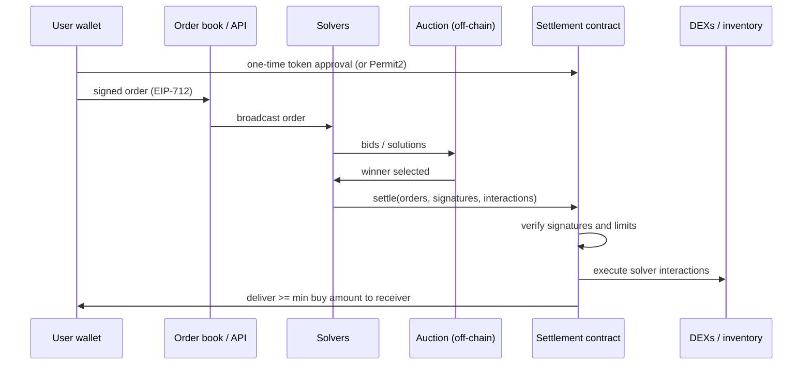

# What Intents Change

In a transaction, the user specifies **how**: call this router with this path. In an **intent**, the user specifies **what**: "I want at least 1,000 USDC for 0.4 ETH before time T". Third parties (solvers, fillers, resolvers) compete to fulfil it. CoW Protocol, UniswapX, 1inch Fusion and cross-chain systems (e.g. those following ERC-7683) work this way.

## Security model shift

| Aspect | Transactions | Intents |
|---|---|---|
| Who builds execution | user/wallet | solver |
| What the user signs | specific calls | constraints (min out, deadline, recipient) |
| Main trust | contract + routing | settlement contract enforcing constraints + solver competition |
| MEV exposure | public mempool | solver internalises; competition returns value |

The shift is from **checking a path** to **checking constraints**. With a transaction, an auditor can read the exact calls. With an intent, the calls are chosen later by someone else, so the only on-chain guarantee is whatever the settlement contract enforces about the signed constraints. Anything not encoded as a constraint is left to the solver's discretion, and therefore to the solver's incentives.

## The lifecycle of an intent



Two things here are on-chain and enforceable: the signature checks and the limit checks in the settlement contract. Everything else, including which solver wins and whether surplus is fair, happens off-chain and is enforced by protocol rules, bonds and monitoring.

## New attack surfaces

1. **Intent signature scope:** what exactly does the signed order allow?
2. **Settlement contracts:** they hold approvals from many users and execute solver-provided calls.
3. **Solver contracts:** solvers run their own contracts with funds and approvals, often less audited.
4. **Auction/competition integrity:** collusion, censorship, rule enforcement off-chain.
5. **Cross-chain settlement:** fillers front funds on the destination chain and are repaid via a settlement oracle.

## Worked example

*Execution status: not executed in this book's CI; verify locally. The surplus figures are hand arithmetic.*

We sign a toy EIP-712 order with Foundry's `cast`, inspect it, and then reason about what the user is and is not protected against.

**Step 1: the order as typed data.** Save as `order.json`:

```json
{
  "types": {
    "EIP712Domain": [
      {"name": "name", "type": "string"}, {"name": "version", "type": "string"},
      {"name": "chainId", "type": "uint256"}, {"name": "verifyingContract", "type": "address"}
    ],
    "Order": [
      {"name": "sellToken", "type": "address"}, {"name": "buyToken", "type": "address"},
      {"name": "receiver", "type": "address"}, {"name": "sellAmount", "type": "uint256"},
      {"name": "minBuyAmount", "type": "uint256"}, {"name": "validTo", "type": "uint32"},
      {"name": "nonce", "type": "uint256"}
    ]
  },
  "primaryType": "Order",
  "domain": {"name": "ToySettlement", "version": "1", "chainId": 31337,
             "verifyingContract": "0x5FbDB2315678afecb367f032d93F642f64180aa3"},
  "message": {"sellToken": "0xC02aaA39b223FE8D0A0e5C4F27eAD9083C756Cc2",
              "buyToken": "0xA0b86991c6218b36c1d19D4a2e9Eb0cE3606eB48",
              "receiver": "0x70997970C51812dc3A010C7d01b50e0d17dc79C8",
              "sellAmount": "400000000000000000", "minBuyAmount": "1000000000",
              "validTo": 1900000000, "nonce": 0}
}
```

**Step 2: sign it** with one of Anvil's default development keys (never a real key):

```bash
cast wallet sign --data --from-file order.json --private-key $ANVIL_PK1
```

The output is a 65-byte signature. The user approved exactly the fields above: sell 0.4 WETH, receive at least 1 000 USDC (6 decimals) at the stated receiver, before `validTo`, once.

**Step 3: what the signature does not say.** It says nothing about route, venue, gas, or how much better than 1 000 USDC the fill should be. If the market price is 2 600 USDC/ETH, the fair output is 1 040 USDC. Compare outcomes:

| Path | User receives | Value lost vs fair |
|---|---|---|
| Public-mempool swap, sandwiched to the 1% slippage limit | ≈ 1 029.6 | ≈ 10.4 |
| Intent, competitive solvers, solver keeps 2 USDC margin | 1 038 | 2 |
| Intent, one colluding or lazy solver fills at the limit | 1 000 | 40 |

The third row is the new risk. The user is protected from catastrophe by `minBuyAmount`, but the gap between limit and fair price is protected only by **competition**. That is why auction integrity (Chapter 5) is a security topic, not just an economics one.

**Step 4: identify the approval holder.** In CoW Protocol, users approve the `GPv2VaultRelayer`, not the settlement contract. In UniswapX, users approve Permit2, and the reactor pulls tokens with a witness-bound permit. Write down, for any intent system you review, which contract holds the allowance and what code can make it move tokens. That contract is the crown jewel.

## Common pitfalls

- Treating `minBuyAmount` as the user's expected price; it is only a floor, and wallets often set it loosely.
- Assuming solver competition exists because the protocol allows many solvers; check how many actually win.
- Reviewing only the settlement contract and ignoring the off-chain order book, which can censor or delay orders.
- Forgetting that a long `validTo` lets an order be filled at the limit whenever the market moves against the user.
- Not identifying which contract holds the user's allowance.

## Exercises

1. Sign a CoW Protocol or UniswapX order on a testnet and decode the signed structure.
2. List every field the user signs and what would go wrong if one were missing.
3. Identify which contract holds the user's token approval in each system.
4. Redo the Step 3 table for a 0.5% slippage setting and a 0.1% `minBuyAmount` gap. At what solver count does competition beat the tight-slippage swap?

## Further reading

- CoW Protocol docs: <https://docs.cow.fi>
- UniswapX docs: <https://docs.uniswap.org/contracts/uniswapx/overview>
- ERC-7683 (cross-chain intents): <https://eips.ethereum.org/EIPS/eip-7683>
- 1inch Fusion docs: <https://docs.1inch.io>
- Foundry `cast wallet sign`: <https://getfoundry.sh/cast/reference/wallet>
