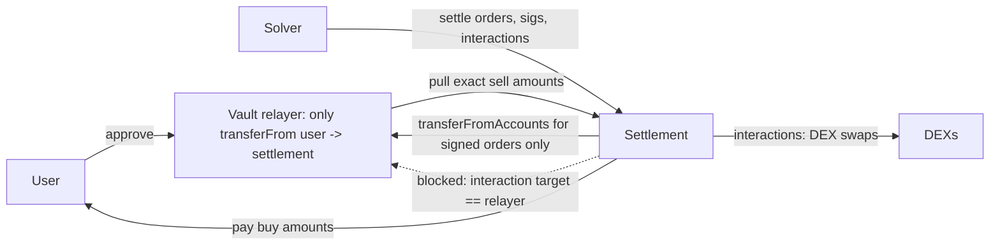

# Settlement Contract Security

Settlement contracts verify orders and execute solver-provided interactions. They are high-value: many users approve them.

## Core invariants

```
S1: tokens leave a user only per a valid signed order
S2: each user receives >= min buy amount (at the signed receiver)
S3: orders cannot be filled beyond their amount (no double fill)
S4: solver interactions cannot move user funds outside S1-S3
S5: only authorised solvers can settle (if permissioned)
```

## Risks

- **Arbitrary interactions:** solvers pass calldata for the settlement contract to execute (to swap on DEXs). If interactions can call token contracts directly, a malicious solver could `transferFrom` users who approved the settlement contract. Designs separate the **vault relayer** or approval holder from the contract executing interactions (CoW's GPv2VaultRelayer pattern) to prevent this.
- **Accounting with fee-on-transfer or rebasing tokens:** balance-based checks may be fooled.
- **Reentrancy** through token hooks during settlement.
- **Hooks:** pre/post hooks for orders add arbitrary code paths.
- **Interaction targets that are themselves privileged:** if the settlement contract holds any role elsewhere (for example it is an allowed minter, or a privileged caller of a vault), arbitrary interactions inherit that role.

## The relayer pattern



The relayer is the only contract with user allowances, and it has exactly one caller (the settlement contract) and one function (pull tokens for orders the settlement verified). The settlement contract can run arbitrary solver interactions because it holds no user allowances, and it refuses interactions that target the relayer. A malicious solver can then lose only the settlement contract's own transient balances, not user funds.

## Testing

Invariant tests with a malicious-solver handler: random interactions, attempts to call tokens, reentrancy, partial fills. S4 is the key invariant.

## Upgradeability and admin powers

Settlement contracts that hold approvals from many users are high-value targets for admin key compromise. Prefer immutable settlement logic with narrowly scoped admin powers (e.g. adding or removing solvers), protected by a multisig and timelock. If upgradeability is required, users should be able to revoke approvals during the timelock. Document every admin function and monitor calls to it.

## Worked example

*Execution status: not executed in this book's CI; verify locally.*

We build the naive single-contract design, exploit it with a malicious-solver interaction, refactor to the relayer pattern, and encode S4 as an invariant.

**Step 1: the naive settlement.**

```solidity
contract NaiveSettlement {
    struct Interaction { address target; uint256 value; bytes data; }

    function settle(Order[] calldata orders, bytes[] calldata sigs,
                    Interaction[] calldata ints) external onlySolver {
        for (uint256 i; i < orders.length; i++) {
            _verify(orders[i], sigs[i]);
            IERC20(orders[i].sellToken).transferFrom(_signer(orders[i], sigs[i]),
                                                     address(this), orders[i].sellAmount);
        }
        for (uint256 j; j < ints.length; j++) {
            (bool ok,) = ints[j].target.call{value: ints[j].value}(ints[j].data);
            require(ok);
        }
        for (uint256 i; i < orders.length; i++) _payOut(orders[i]);   // checks minBuyAmount
    }
}
```

Users approve `NaiveSettlement` directly.

**Step 2: the exploit.** A malicious (or compromised) solver submits a settlement with zero orders and one interaction:

```solidity
Interaction memory steal = Interaction({
    target: address(weth), value: 0,
    data: abi.encodeCall(IERC20.transferFrom, (victim, solver, weth.balanceOf(victim)))
});
settlement.settle(new Order[](0), new bytes[](0), _one(steal));
```

The call comes from the settlement contract, which holds the victim's allowance, so it succeeds. In a test, assert `weth.balanceOf(victim) == 0` after the call. S1 and S4 are both violated; no signature was ever checked.

**Step 3: the refactor.**

```solidity
contract VaultRelayer {
    address public immutable settlement;
    constructor() { settlement = msg.sender; }
    function pull(IERC20 t, address from, uint256 amt) external {
        require(msg.sender == settlement, "only settlement");
        t.transferFrom(from, settlement, amt);
    }
}
```

The settlement contract deploys the relayer in its constructor, calls `relayer.pull` only inside the order loop for verified orders, and rejects any interaction with `target == address(relayer)`. Users now approve the relayer.

**Step 4: the invariant.** A handler acting as a malicious solver calls `settle` with random interactions, including `transferFrom` on every token, calls into the relayer, and reentrant callbacks. Track a ghost variable of what each user *should* have lost under their signed orders:

```solidity
function invariant_S4_noUnauthorisedOutflow() public view {
    for (uint256 u; u < users.length; u++) {
        assertGe(weth.balanceOf(users[u]) + handler.signedSpend(users[u]),
                 initialBalance[users[u]]);
    }
}
```

Run `forge test --mt invariant_S4 -vv` against the naive contract first: it should fail quickly with a shrunk sequence that is essentially Step 2. Against the refactored version it should pass. Keep both runs in the write-up; the failing one proves the harness can detect the bug.

**Step 5: a token edge case.** Add a fee-on-transfer token with a 1% fee. If `_payOut` checks `minBuyAmount` against the amount sent rather than the receiver's balance change, S2 fails by 1%. Measure the receiver's balance before and after, or exclude such tokens explicitly.

## Common pitfalls

- One contract holding user allowances and executing arbitrary solver calls.
- Blocking interactions to the relayer but not to other contracts that hold allowances or roles for the settlement.
- Checking payouts by amount sent rather than balance received.
- Reentrancy through ERC-777-style hooks or ETH refunds during payout.
- Order fill tracking that keys on a hash missing the owner, letting one user's fill state collide with another's.
- Upgradeable settlement without a timelock long enough for users to revoke approvals.

## Exercises

1. Build a toy settlement contract where the same contract holds approvals and executes interactions. Show the malicious-solver exploit.
2. Refactor to a relayer pattern and prove S4 with invariant tests.
3. Add a fee-on-transfer token and check S2.
4. Give the settlement contract a minter role on a toy token and show how arbitrary interactions abuse it, even with the relayer pattern in place.

## Further reading

- CoW Protocol contracts (GPv2Settlement, GPv2VaultRelayer): <https://github.com/cowprotocol/contracts>
- UniswapX reactors: <https://github.com/Uniswap/UniswapX>
- Foundry invariant testing: <https://book.getfoundry.sh/forge/invariant-testing>
