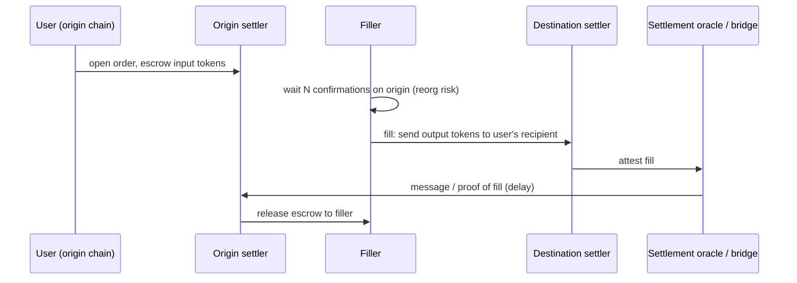

# Solver and Filler Security

Solvers are businesses running bots and contracts with significant capital. They are targets, and when compromised, they can harm users.

## Solver contract risks

- Solvers often deploy custom executor contracts holding inventory and approvals. Bugs in these (unprotected functions, unverified callbacks) have led to losses. For example, in March 2025 1inch reported that an outdated Fusion v1 resolver contract was exploited for roughly US$5M; user funds were reported unaffected.
- Callback verification (DEX callbacks into solver contracts) must check the caller (see **mev-security-engineering** Chapter 4).
- **Stale deployments:** old executor versions often keep approvals and inventory after the team moves on. They are rarely monitored and rarely re-audited.

## Operational risks

- Hot keys signing settlement transactions; key compromise.
- Price feed manipulation fooling solver quoting.
- Bugs causing systematically bad fills (users protected by min-out, solver loses money).

## Solver misbehaviour against users

- **Collusion** among solvers to keep surplus low.
- **Censorship** of certain orders.
- **Rule violations** in off-chain auction rules (e.g. not delivering promised surplus). Protocols handle this with solver bonds, slashing via governance, and monitoring.

## Cross-chain fillers

Fillers front funds on the destination chain and are repaid on the origin after a settlement message or proof. Risks: settlement oracle failure (filler not repaid), double repayment, and reorgs on the origin chain causing fillers to deliver for orders that disappear.



The filler carries risk from the moment it sends funds on the destination chain until the escrow is released: origin reorg, oracle failure or delay, and bugs that release the escrow to the wrong party or twice.

## Worked example

*Execution status: not executed in this book's CI; verify locally. The risk pricing is hand arithmetic.*

Two parts: securing a solver executor's Uniswap V3 callback, and pricing a filler's risk.

**Part A: the callback.** A solver executor that swaps on Uniswap V3 implements `uniswapV3SwapCallback`, which the pool calls to collect payment. The vulnerable version:

```solidity
function uniswapV3SwapCallback(int256 a0, int256 a1, bytes calldata data) external {
    (address tokenIn) = abi.decode(data, (address));
    uint256 owed = uint256(a0 > 0 ? a0 : a1);
    IERC20(tokenIn).transfer(msg.sender, owed);    // BUG: msg.sender not verified
}
```

Anyone can call it with `data = abi.encode(WETH)` and a large `a0`, and the executor pays them its WETH inventory. Exploit test: from an attacker address, call `executor.uniswapV3SwapCallback(int256(weth.balanceOf(executor)), 0, abi.encode(weth))` and assert the attacker's balance rose.

The fix verifies that the caller is a genuine pool by recomputing its address from the factory and pool key:

```solidity
function uniswapV3SwapCallback(int256 a0, int256 a1, bytes calldata data) external {
    (address t0, address t1, uint24 fee) = abi.decode(data, (address, address, uint24));
    address pool = PoolAddress.computeAddress(FACTORY, PoolAddress.getPoolKey(t0, t1, fee));
    require(msg.sender == pool, "bad callback");
    uint256 owed = uint256(a0 > 0 ? a0 : a1);
    IERC20(a0 > 0 ? t0 : t1).transfer(msg.sender, owed);
}
```

`PoolAddress` is the helper library from Uniswap V3 periphery; check that the init code hash it uses matches the chain you deploy on. Add a second guard: a transient "swap in progress" flag set by the executor before calling the pool and checked in the callback, so even a real pool cannot trigger a payment outside a swap you started.

**Part B: pricing filler risk.** A filler is offered an ERC-7683-style order: deliver 100 000 USDC on the destination, receive 100 050 USDC on the origin after a 15-minute settlement delay.

| Item | Value |
|---|---|
| Fee earned | 50 USDC (5 bps) |
| Capital locked | 100 000 USDC for ~15 min |
| Cost of capital at 10% APR for 15 min | ≈ 100 000 × 0.10 × 15 / 525 600 ≈ 0.29 USDC |
| Break-even probability of total loss | 50 / 100 000 = 0.05% |

If the filler waits for origin finality before filling, reorg risk on Ethereum is negligible, but the user waits longer and a faster filler wins the order. If the filler fills after one confirmation on a chain where deep reorgs have historically happened, or the settlement oracle has had outages, a probability of loss above 1 in 2 000 makes every fill negative expected value. This arithmetic is why fillers set per-chain confirmation policies and why protocols that shorten confirmation requirements push risk onto fillers, who then quote wider.

## Common pitfalls

- Callbacks that trust `msg.sender` or decode the token to pay from caller-supplied data.
- Leaving old executor versions deployed with approvals and inventory.
- Executor `withdraw` or `sweep` functions with missing or wrong access control.
- Solver hot keys with permission to move inventory, not just to submit settlements.
- Fillers using one confirmation policy for all origin chains.
- Repayment logic that can be triggered twice for one fill (missing fill-ID bookkeeping on the origin).

## Exercises

1. Audit a sample solver executor contract for unprotected functions and callback checks.
2. Model filler risk for an ERC-7683-style order with a 15-minute settlement delay and origin-chain reorg probability.
3. Write monitoring for solver surplus distribution to detect collusion.
4. Write an invariant test for an executor: no sequence of external calls by a non-owner reduces its token balances.

## Further reading

- 1inch incident statement (March 2025): <https://blog.1inch.io>
- CoW Protocol solver rules and bonding: <https://docs.cow.fi>
- ERC-7683: <https://eips.ethereum.org/EIPS/eip-7683>
- Uniswap V3 periphery (`PoolAddress`, callback validation): <https://github.com/Uniswap/v3-periphery>
