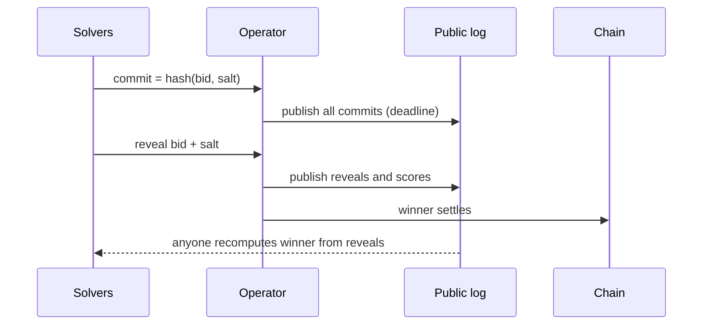

# Auction Integrity

Intent systems run auctions (batch auctions, Dutch auctions, RFQ) to choose solvers. Many rules are enforced off-chain.

Chapter 1 showed that the gap between a user's limit price and the fair price is protected only by competition. The auction is where that competition happens, so its integrity is a direct user-protection property. A settlement contract can be flawless while an operator quietly routes the best orders to a favoured solver.

## Auction formats

| Format | How the winner is chosen | Main integrity question |
|---|---|---|
| Batch auction (e.g. CoW) | solvers submit solutions for a batch; the one with the best score wins | is the scoring rule applied as published? |
| Dutch auction (e.g. UniswapX) | price decays over time until a filler takes it | can someone see orders early or manipulate the decay start? |
| RFQ | market makers quote; best quote wins | did the operator show all quotes, and can winners back out? |

## Threats

| Threat | Example |
|---|---|
| Information leakage | auction operator leaks orders to a favoured solver |
| Collusion | solvers coordinate bids |
| Shill bidding | fake solvers to manipulate outcomes |
| Last-look abuse | solver wins, then declines unfavourable fills |
| Operator censorship | operator excludes orders or solvers |

## Mitigations

- Publish auction data for post-hoc verification (all bids, winner, surplus).
- Bonds and slashing for rule violations.
- Decentralise or rotate the auction operator; or use verifiable mechanisms (commit–reveal bids, TEEs for sealed-bid auctions, see **tee-attack-engineering**).
- Monitoring dashboards for surplus and win distribution.



Commit–reveal stops solvers from adapting to each other's bids and stops the operator from inserting late bids, provided commits are published before reveals. It does not stop a solver from refusing to reveal (a form of last look); that needs a bond forfeited on non-reveal.

## Verifiability

Ask: can an outsider recompute the auction outcome from public data and confirm the rules were followed? If not, users trust the operator.

## Worked example

*Execution status: executed. The script below was run with Python 3 when this chapter was written, and the output shown is what it printed. The data are toy values, not real auction records.*

We recompute declared winners from published bids and compute a simple concentration indicator. The same structure applies to real published auction data, after mapping its fields.

```python
from collections import Counter
# Published auction data: per auction, each solver's claimed surplus (USD) and the declared winner.
auctions = [
    {"id": 1, "bids": {"alpha": 120.0, "beta": 118.5, "gamma": 95.0}, "winner": "alpha"},
    {"id": 2, "bids": {"alpha": 40.0, "beta": 44.2, "gamma": 43.9},  "winner": "beta"},
    {"id": 3, "bids": {"alpha": 310.0, "beta": 290.0},                "winner": "beta"},
    {"id": 4, "bids": {"beta": 15.0, "gamma": 15.0},                  "winner": "gamma"},
]
for a in auctions:
    best = max(a["bids"].values())
    top = sorted(s for s, v in a["bids"].items() if v == best)
    ok = a["winner"] in top
    print(f"auction {a['id']}: declared {a['winner']:<6} recomputed {'/'.join(top):<12} {'OK' if ok else 'MISMATCH'}")

wins = Counter(a["winner"] for a in auctions)
n = sum(wins.values())
hhi = sum((w / n) ** 2 for w in wins.values())
print("win shares:", {s: round(w / n, 2) for s, w in wins.items()}, "HHI:", round(hhi, 3))
```

Output:

```text
auction 1: declared alpha  recomputed alpha        OK
auction 2: declared beta   recomputed beta         OK
auction 3: declared beta   recomputed alpha        MISMATCH
auction 4: declared gamma  recomputed beta/gamma   OK
win shares: {'alpha': 0.25, 'beta': 0.5, 'gamma': 0.25} HHI: 0.375
```

**Reading it.** Auction 3 declared `beta` the winner although `alpha` offered US$20 more surplus. Either the published rule is not the rule applied (perhaps a hidden penalty or a solver allowlist), or the data are incomplete, or the operator favoured `beta`. Each is worth a question to the protocol. Auction 4 is a tie: the published rules must specify a tie-break, and the recomputation should apply it rather than accept any tied winner.

The Herfindahl–Hirschman index (HHI) of win shares is 0.375 here. With three equal solvers it would be 0.333; with one solver winning everything it is 1. On real data, track HHI over time alongside average surplus per order. Rising concentration with falling surplus is the pattern that collusion or information leakage would produce. It is an indicator, not proof: a solver can win more simply because it is better.

**Next steps on real data.** Replace the toy list with published auction records, encode the protocol's actual scoring rule (including fees, penalties and tie-breaks), and confirm that the winner's on-chain settlement delivered at least the surplus it claimed by reading the settlement transaction's transfers. The chain is the final checker for the claimed surplus.

## Common pitfalls

- Trusting dashboards built by the operator rather than recomputing from raw data.
- Recomputing winners with a simplified rule and then reporting "mismatches" that are really undocumented rule details. Ask before alleging misconduct.
- Ignoring tie-break rules.
- Treating high concentration alone as evidence of collusion.
- Commit–reveal schemes without a bond for non-reveal, which reintroduces last look.
- Not checking that claimed surplus matches what settled on-chain.

## Exercises

1. Recompute the winner of several historical batch auctions from published data.
2. Design a commit–reveal bidding scheme for a solver auction and analyse last-look risks.
3. Build a collusion indicator from win-rate and surplus statistics.
4. Extend the script to compare each winner's claimed surplus with the surplus implied by its settlement transaction's token transfers.

## Further reading

- CoW Protocol auction docs and data: <https://docs.cow.fi>
- Flashbots research on orderflow auctions: <https://writings.flashbots.net>
- UniswapX auction mechanics: <https://docs.uniswap.org/contracts/uniswapx/overview>
