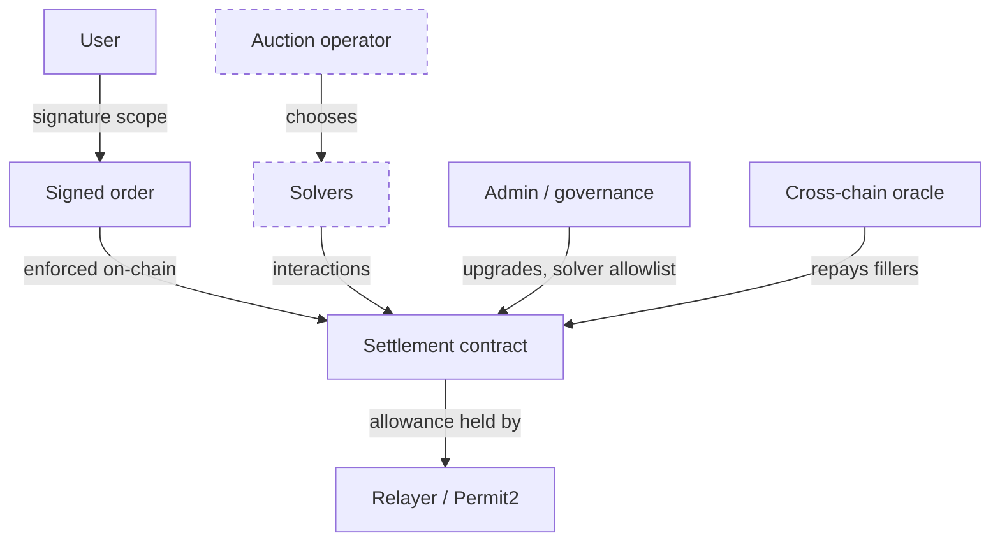

# Intent Protocol Audit Checklist

This chapter condenses the book into a checklist and then walks one item from claim to verified finding.

## Orders
- [ ] All fields bound in signatures (Chapter 2 table).
- [ ] EIP-712 domain includes chain ID and verifying contract.
- [ ] Nonce/uid prevents replay; cancellation works.
- [ ] Witness types (Permit2) hashed correctly.
- [ ] Settlement reads every constraint from the signed order, never from solver calldata.

## Settlement
- [ ] Approval holder separated from interaction executor.
- [ ] Invariants S1–S5 tested with malicious-solver handlers.
- [ ] Non-standard tokens handled or excluded.
- [ ] Hooks sandboxed or restricted.
- [ ] Settlement contract holds no roles elsewhere that interactions could abuse.

## Solvers
- [ ] Solver contracts audited; callbacks verified.
- [ ] Bonding and slashing rules objective.
- [ ] Solver key management reviewed.
- [ ] Old executor deployments drained and approvals revoked.

## Auctions
- [ ] Rules published; outcomes recomputable.
- [ ] Monitoring for collusion and censorship.

## Cross-chain
- [ ] Settlement oracle security reviewed (bridge risks).
- [ ] Reorg handling for fillers.
- [ ] Double-repayment prevention.

## Trust map



Dashed boxes are enforced off-chain. For each, the audit report should state the residual trust in one sentence: who must behave for users to be safe, and what detects it if they do not.

## Using the checklist with AI assistance

An assistant can map each checklist item to code locations quickly: find the EIP-712 type hash, list the fields it covers, locate approval holders and interaction executors, and list admin functions. Treat each mapping as a claim to verify. For signature scope, the strongest verification is a test that mutates each signed field and expects rejection. For settlement invariants, verification is a fork-based invariant run with a malicious-solver handler.

## Worked example

*Execution status: not executed in this book's CI; verify locally.*

We take one checklist item, "all fields bound in signatures", for a protocol under review and turn it into three independent checks. Suppose an assistant reports: "`ORDER_TYPEHASH` covers sellToken, buyToken, receiver, sellAmount, buyAmount, validTo, appData, feeAmount, kind, partiallyFillable." That is a claim.

**Check 1: the type string matches the constant.** Find the type string in the source and recompute its hash:

```bash
grep -rn "TYPE_HASH\|TYPEHASH" src/
cast keccak "Order(address sellToken,address buyToken,address receiver,uint256 sellAmount,uint256 buyAmount,uint32 validTo,bytes32 appData,uint256 feeAmount,string kind,bool partiallyFillable,string sellTokenBalance,string buyTokenBalance)"
```

Compare the result with the hard-coded constant in the contract. If the contract stores a precomputed `bytes32` instead of `keccak256("...")`, this is the only way to know which fields it really covers. In this hypothetical, the string has twelve fields; the assistant listed ten. The two it missed (`sellTokenBalance`, `buyTokenBalance`) control where tokens are pulled from and paid to, so they matter.

**Check 2: the encoder matches the type string.** Read the hashing function. Every field in the type string must appear in the same order in the encoding, with `string` and `bytes` hashed. A quick way to catch mismatches is to sign typed data with an independent implementation (`cast wallet sign --data` with a JSON order) and verify it on-chain with the contract's own `isValidSignature` or verification function on a fork. Agreement means the contract's encoding is standard.

**Check 3: settlement honours each field.** For each field, write a test that signs an order and then tries to settle in a way that violates that field (different receiver, more sell amount, expired `validTo`, partial fill when not allowed, different balance source). Each must revert or deliver per the signed value. This is the check that catches Chapter 2's subtle bug where the hash is right but settlement reads calldata.

**Write-up.** Record the assistant's claim, the three checks, and their results in the report. Where the claim was incomplete (here, two missing fields), say so; it calibrates how much to trust later assistant output in the same audit. The model proposed; `cast keccak`, the fork verification and the tests decided.

## Common pitfalls

- Ticking a checklist box on the strength of reading code once, without a test.
- Accepting an assistant's field list without recomputing the type hash.
- Auditing the settlement contract but treating the relayer, Permit2 integration and hooks as out of scope.
- Writing no residual-trust statement for off-chain components.
- Ignoring admin functions that can change the solver allowlist or fee parameters without delay.

## Exercises

1. Apply the checklist to one intent protocol's public contracts.
2. Write invariant tests for S1–S5 on its settlement contract (fork).
3. Summarise residual trust assumptions in one paragraph.
4. Perform the three checks of the worked example on a real protocol's order type and record where an assistant's initial summary was wrong or incomplete.

## Further reading

- See **mev-security-engineering**, **cross-chain-bridge-security** and **web3-supply-chain-security** in this wiki.
- CoW Protocol `GPv2Order` library: <https://github.com/cowprotocol/contracts>
- Foundry `cast keccak`: <https://getfoundry.sh/cast/reference/keccak>
